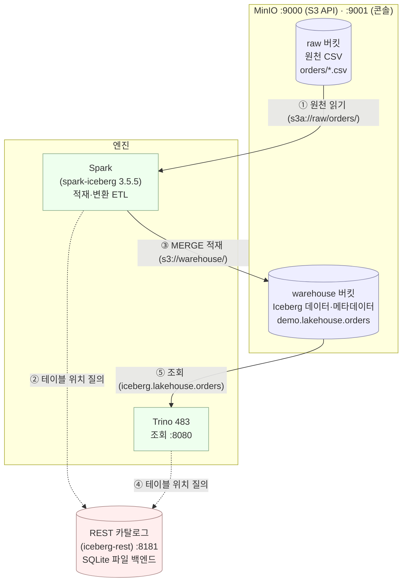

# 4주차 산출물 — 레이크하우스 아키텍처

## 0. 아키텍처 다이어그램

## 1. 구성

| 구성 요소 | 역할 | 포트 | 없으면 |
|---|---|---|---|
| MinIO | 파일을 담는 오브젝트 스토리지 (raw·warehouse 버킷) | 9000·9001 | 저장할 곳이 없다 |
| Iceberg | 파일 묶음을 테이블처럼 다루는 테이블 포맷 | — | 무엇이 현재 상태인지 모른다 |
| REST 카탈로그 | 테이블 → 최신 메타데이터 위치 (iceberg-rest, SQLite 백엔드) | 8181 | 엔진끼리 같은 테이블을 못 본다 |
| Spark | 적재·변환 (MERGE 멱등 적재) | — | 대량 쓰기를 할 수 없다 |
| Trino | 대화형 조회·집계 | 8080 | 빠른 분석 질의가 어렵다 |

## 2. 데이터 흐름

1. 원천 CSV가 raw 버킷에 도착 (랜딩 존)
2. Spark가 `s3a://raw/orders/`로 읽어 정제 (형 변환 · 불량 제거 · 키별 최신 한 행)
3. `MERGE INTO demo.lakehouse.orders`로 Iceberg 테이블에 멱등 적재
4. 커밋 시점에 카탈로그 포인터가 바뀌며 비로소 보임
5. Trino가 같은 카탈로그(`iceberg.lakehouse.orders`)를 통해 조회·집계

## 3. 검증한 것

- Trino INSERT → Spark에서 즉시 조회됨
- Spark ALTER/UPDATE → Trino DESCRIBE에 반영됨
- 두 엔진의 count·sum·스냅샷 개수가 정확히 일치
- 실패한 쓰기는 커밋되지 않아 어디에도 안 보임

## 4. 한계와 다음 단계

- 랜딩 존 전체를 매번 다시 읽는다 → 날짜 파티션으로 개선 필요
- 파이프라인을 손으로 실행한다 → 8주차 Airflow로 스케줄링

## 5. 하면서 걸렸던 것들

- 같은 `MERGE` 스크립트를 두 번 돌려도 행 수가 안 늘어나는 걸 보고 멱등이 뭔지 감이 왔다. 처음엔 중복으로 쌓일 줄 알았는데 `ON order_id` 매칭 덕에 갱신으로 흡수됐다.
- `etl_bad.py`로 돌려 보니 `orders_bad.csv`의 음수 금액(-5000)과 키 없는 행이 그대로 테이블에 들어갔다. 반대로 `etl_orders.py`는 `filter`와 `row_number`로 이걸 걸러낸다. 정제 로직을 뺀 버전을 직접 돌려 보니 왜 필요한지가 체감됐다.
- 같은 order_id가 날짜만 다르게 여러 번 들어오면 `row_number`로 최신 한 행만 남긴다는 걸, 중복 안 줄인 버전과 비교하고서야 이해했다.
- 카탈로그가 왜 따로 필요한지 처음엔 몰랐는데, Spark로 쓴 테이블이 Trino에서 바로 보이는 걸 보고 "둘이 같은 포인터를 본다"는 말이 와닿았다. `rest-catalog` 볼륨을 안 걸면 `down` 후 테이블 목록이 날아간다는 주석도 그제서야 이해됨.
- s3 경로 표기가 엔진마다 달라서 헷갈렸다. Spark 읽기는 `s3a://`, 카탈로그·Trino 설정은 `s3://`.
