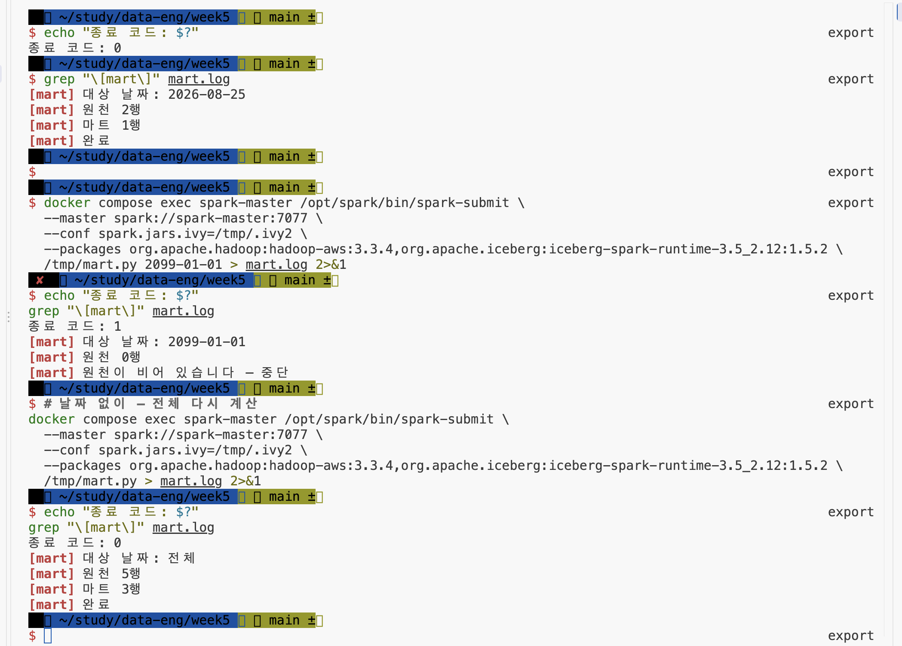

# 5주차 산출물 — 일별 매출 데이터 마트

## 1. 구성
- 클러스터: Spark Standalone (마스터 1 + 워커 N) · Docker Compose
- 저장소: MinIO (s3a) · Iceberg (hadoop 카탈로그)
- 배치: mart.py — spark-submit으로 실행

## 2. 처리 흐름
1. 원천 주문·상품 데이터 읽기
2. 조인 후 amount 파생 (qty × price)
3. 날짜별 집계 (daily_amount · order_cnt)
4. coalesce(1) 후 Iceberg 테이블로 교체 저장

## 3. 실행
```
docker compose cp mart.py spark-master:/tmp/mart.py
docker compose exec spark-master /opt/spark/bin/spark-submit \
  --master spark://spark-master:7077 \
  --conf spark.jars.ivy=/tmp/.ivy2 \
  --packages org.apache.hadoop:hadoop-aws:3.3.4,org.apache.iceberg:iceberg-spark-runtime-3.5_2.12:1.5.2 \
  /tmp/mart.py [날짜] > mart.log 2>&1
echo "종료 코드: $?"
```

## 4. 실측 (본인 환경)


## 5. 확인한 것
- 두 번 실행해도 결과 동일 (createOrReplace로 멱등)
- 없는 날짜를 주면 종료 코드 1로 실패
- 한 번 저장에 파일 1개 (coalesce 효과 — 다시 돌리면 옛 판 파일이 스냅샷으로 남음)